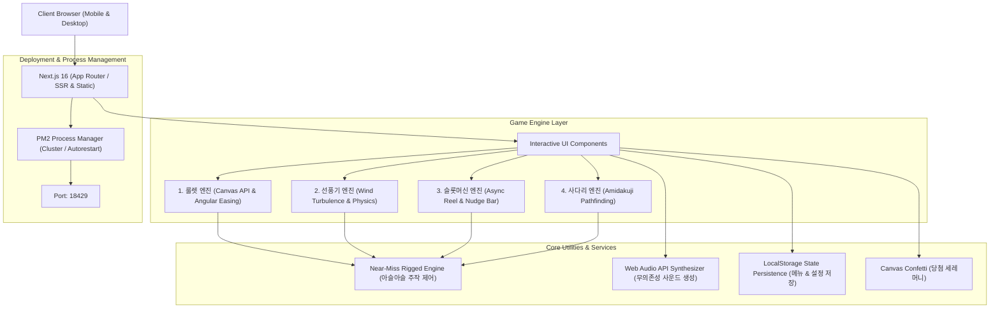

# 🍱 골라골라 점심추천 (GolaGola Lunch) - 개발 설계 문서 (Design Document)

## 1. 개요 (Overview)
**골라골라 점심추천**은 직장인과 모임의 결정장애를 해소하기 위해 기획된 인터랙티브 점심 메뉴 추천 웹 애플리케이션입니다.  
사용자 친화적인 인터페이스와 모바일 최적화 환경에서 4가지 게임(돌림판 룰렛, 선풍기 종이 날리기, 카지노 슬롯머신, 사다리 타기)을 통해 메뉴를 선정하며, 자연스러운 긴장감을 자아내는 **아슬아슬 역전/강제 당첨(Near-Miss Rigged Engine)** 기능을 갖추고 있습니다.

---

## 2. 시스템 아키텍처 (System Architecture)



---

## 3. 기술 스택 (Tech Stack)

| 구분 | 기술 / 라이브러리 | 버전 | 선정 이유 |
| :--- | :--- | :--- | :--- |
| **Framework** | Next.js (App Router, Turbopack) | 16.4.0 | 고성능 정적 프리렌더링 및 모던 React 19 아키텍처 지원 |
| **UI Library** | React | 19.3.0 | 최신 컴포넌트 모델 및 상태 동기화 |
| **Styling** | Tailwind CSS v4 | 4.x | 경량 유틸리티 클래스 기반 빠른 반응형 디자인 |
| **Icons** | Lucide React | 1.57.0 | 직관적이고 통일감 있는 벡터 아이콘 |
| **Graphics** | HTML5 Canvas API | Native | 고주사율(60~120fps) 부드러운 룰렛/사다리 렌더링 |
| **Sound** | Web Audio API | Native | 외부 mp3 파일 다운로드 없이 브라우저 내장 오실레이터로 경쾌한 효과음 합성 |
| **Effects** | Canvas Confetti | 1.9.4 | 경량화된 당첨 세레머니 파티클 효과 |
| **Process Manager** | PM2 | 6.0.10 | 무중단 서비스 운영, 포트(18429) 제어 및 로그 로테이션 |

---

## 4. 컴포넌트 계층 구조 (Component Hierarchy)

```
src/
├── app/
│   ├── layout.tsx         # 전역 레이아웃, 메타데이터, 다크 테마 설정
│   ├── globals.css        # Tailwind 전역 스타일
│   └── page.tsx           # 메인 페이지 컨트롤러 (상태 관리, 모달 오케스트레이션)
├── components/
│   ├── Header.tsx         # 모드 전환 바, 사운드 On/Off, 설정 모달 트리거
│   ├── ResultModal.tsx    # 당첨 결과 세레머니, Confetti 발사, 클립보드 공유
│   ├── SettingsModal.tsx  # 10대 메뉴 편집 및 강제 당첨(아슬아슬 주작) 설정 창
│   └── games/
│       ├── RouletteGame.tsx    # 1. 룰렛 돌림판 (HTML5 Canvas 기반)
│       ├── FanGame.tsx         # 2. 선풍기 바람 종이 날리기 (풍속/거리 물리 시뮬레이션)
│       ├── SlotMachineGame.tsx # 3. 카지노 슬롯머신 (3릴 + 레버 + 넛지 기믹)
│       └── LadderGame.tsx      # 4. 사다리 타기 (아미다쿠지 경로 탐색)
├── types/
│   └── lunch.ts           # 메뉴 및 게임 모드, 주작 설정 타입 정의
└── utils/
    ├── audio.ts           # Web Audio API 기반 오디오 신디사이저
    └── storage.ts         # LocalStorage 입출력 및 당첨자 산출 알고리즘
```

---

## 5. 핵심 게임 알고리즘 및 엔진 상세 설계

### 5.1. 룰렛 돌림판 (`RouletteGame.tsx`)
- **렌더링**: Canvas 2D 컨텍스트를 활용하여 `sliceAngle = 2π / N`으로 피자 조각 형태의 호(Arc)를 렌더링하고, 바깥 테두리에 카지노 전구 애니메이션을 배치.
- **감속 이징 곡선 (Deceleration Easing)**:
  $$Ease(p) = 1 - (1 - p)^{3.2}$$
- **아슬아슬 연출 (Near-Miss Logic)**:
  - 포인터(12시 방향, $1.5\pi$) 아래에 멈출 목표 각도 계산 시, 목표 메뉴 슬라이스의 경계선 바로 직전($-0.38 \times sliceAngle$)에 멈추도록 유도한 뒤, 마지막 프레임에서 점진적 미세 스텝(Creep)을 주어 옆 칸에서 틱 넘어가며 멈추게 설계.

### 5.2. 선풍기 바람에 종이 날리기 (`FanGame.tsx`)
- **컨셉**: 탁상용 터보 서큘레이터에서 뿜어져 나오는 풍속에 의해 책상(0m ~ 20m 트랙) 위에서 10개의 종이 쪽지가 날아감.
- **물리 시뮬레이션 모델**:
  - $Distance(t) = TargetDist \times (1 - (1 - \frac{t}{T})^{2.5})$
  - 종이의 펄럭임(Flutter): $Rotation = \sin(t \times 25 + dist \times 3) \times 12^\circ$
- **아슬아슬 연출 (Sudden Gust Mechanic)**:
  - 라이벌 메뉴가 초반에 1위로 치고 나가며 앞서감.
  - 진행률 65%~88% 구간에서 **돌풍(Sudden Gust)** 이벤트가 발생하여, 뒤처져 있던 목표 메뉴가 공중 텀블링과 함께 결승선 0.1m 차이로 역전 피니시.

### 5.3. 카지노 슬롯머신 (`SlotMachineGame.tsx`)
- **컨셉**: 3개의 릴과 실제 당길 수 있는 슬롯 레버 인터랙션.
- **릴 순차 정지 타임라인**:
  - 0.0s: 레버 당김 및 전체 릴 고속 회전 (Tick 사운드)
  - 1.8s: Reel 1 정지 (목표 메뉴 고정)
  - 2.8s: Reel 2 정지 (목표 메뉴 일치로 긴장감 고조)
  - 4.0s: Reel 3 정지
- **아슬아슬 연출 (Reel Nudge Mechanic)**:
  - 4.0s 시점에 Reel 3이 억울하게 **1칸 차이(라이벌 메뉴)**에 멈춤 ("어? 꽝인가?!").
  - 0.85초 정적 후 기계적 튕김 사운드와 함께 **슬롯 넛지(Nudge)**가 발생하여 1칸 아래로 튕겨내려오며 3연속 잭팟 완성.

### 5.4. 사다리 타기 (`LadderGame.tsx`)
- **컨셉**: 한국 전통 아미다쿠지(Amidakuji).
- **경로 생성 알고리즘 (Guaranteed Path Generation)**:
  - 시작 열($Col_{start}$)에서 목표 메뉴($Col_{goal}$)로 도달하도록 수평 가로줄(Rung)을 유전적 시뮬레이션 방식으로 검증/배치.
- **아슬아슬 연출**:
  - 러너가 내려가는 도중 계속 엉뚱한 인기 메뉴 쪽으로 치우치다가, 바닥에 닿기 직전 마지막 하단 가로줄($Y \approx 0.88$)에서 급격히 꺾여 목표 메뉴로 골인.

---

## 6. 비밀 강제 당첨 시스템 (Near-Miss Rigged Engine)

직장 동료들과의 점심 내기에서 자연스러움과 극적 재미를 부여하기 위해 설계되었습니다.

1. **설정 은닉성**: 설정 창 내부의 탭 분리(`비밀 강제 당첨`)를 통해 필요할 때만 조작 가능.
2. **라이벌 자동 선정**: 목표 메뉴의 바로 인접한 인덱스 또는 무작위 1개 메뉴를 '경쟁자(Runner-Up)'로 자동 지정하여 시각적인 대립 구도 형성.
3. **자연스러운 역전**: "1등 확정"이 바로 드러나는 것이 아니라, 경기 종료 0.5초 전까지 타 메뉴가 당첨될 것처럼 보이다가 마지막 순간에 역전되도록 구현.
4. **순수 랜덤 모드 복귀**: 토글 해제 시 100% 공정한 암호학적 의사난수(`Math.random`)로 당첨자 결정.

---

## 7. 오디오 아키텍처 (Web Audio API Synthesizer)

외부 오디오 리소스 로딩 지연을 없애기 위해 Web Audio API 오실레이터를 합성하여 소리를 만듭니다.

- `playTick()`: Triangle 파형을 이용한 600Hz $\to$ 120Hz 고속 피치 강하 틱 사운드.
- `playWind()`: 화이트 노이즈 버퍼와 밴드패스 필터(Bandpass Filter, 400~1200Hz)를 결합한 바람 소리.
- `playLever()`: 180Hz 톱니파(Sawtooth) 기계식 레버 음.
- `playReelStop()`: Square 파형의 둔탁한 릴 잠금음.
- `playFanfare()`: C5, E5, G5, C6 트라이앵글 코드 4단계 화음 아르페지오 세레머니.

---

## 8. PM2 배포 및 인프라 설계

- **설정 파일**: `ecosystem.config.js`
- **지정 포트**: `18429` (포트 충돌 없는 독립 포트)
- **메모리 보호**: `max_memory_restart: "500M"`
- **관리 스크립트 모음**:
  - `scripts/build.sh`: Next.js 프로덕션 빌드
  - `scripts/start.sh`: 무중단 프로세스 구동 및 설정 영구 저장(`pm2 save`)
  - `scripts/stop.sh`: 안전 종료
  - `scripts/restart.sh`: 무중단 재기동
  - `scripts/logs.sh`: 실시간 로그 스트리밍
  - `scripts/status.sh`: 프로세스 리소스 점유 상태 확인
